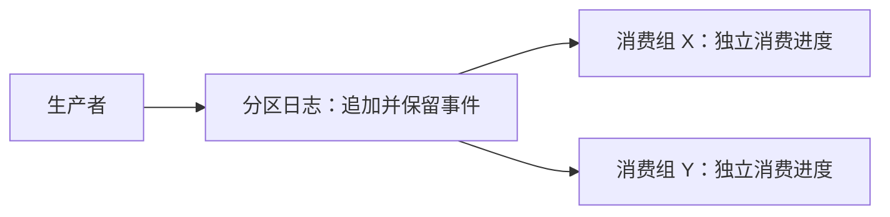

# 从消息队列到分区日志

状态：已学习，用户已确认核心模型｜优先级：重点

核心问题：为什么消息被消费后仍要保留，消费进度与消息存储为什么要分开？

## Step 1：从 RabbitMQ 的队列模型出发

以你熟悉的常规 AMQP 队列为例：

```text
生产者 → Queue：[A][B][C] → 消费者
                              ↓
                         处理 A，返回 ACK
                              ↓
                      A 从该队列逻辑移除
```

队列主要记录“还有哪些消息需要处理”。A 确认后，通常不能再从这个队列读取 A。

同一队列的多个消费者通常分摊消息。若通知系统、统计系统都要收到每条消息，可以用 Exchange 路由到各自的队列，各自消费和确认。

## Step 2：为什么要换一个存储模型

如果要求：

- 多个系统独立读取同一批事件，消费速度互不影响。
- 新系统上线后，可以读取仍然保留的历史事件。
- 处理逻辑修正后，可以重新读取历史事件。

就需要让“事件是否存在”和“某个系统读到哪里”分别记录。

## Step 3：Kafka 保存日志，消费方记录位置

这里的日志是**按顺序追加的业务事件记录**，不是程序打印的运行日志。先只看一个分区：

```text
共享日志：  [A][B][C][D][E] ← 新事件追加到末尾
Offset：    0  1  2  3  4

消费组 X：已处理 A、B、C，提交的下一读取位置 = 3
消费组 Y：已处理 A，提交的下一读取位置 = 1
```

Offset 是消息在分区内的逻辑编号，不是文件字节地址；不同分区分别编号。

分区可以理解为一份有序日志。日志的保留与清理由 Broker 按配置执行；不同消费组独立记录进度，同组消费者通过分区分配协作。

**X、Y 读取同一份逻辑日志，分别维护消费进度。** X 的进度前进，不会删除 A、B、C，也不会推动 Y 的进度。

提交 Offset 记录的是恢复消费的位置，通常为下一条要读取的消息编号。本节先理解其作用，提交时机和故障窗口后续展开。



因此，Kafka 将两个状态解耦：

| 状态 | 回答的问题 | 变化方式 |
| --- | --- | --- |
| 消息存储 | 哪些事件还存在？ | 追加事件，按保留或压缩策略清理 |
| 消费进度 | 这个消费组读到哪里？ | 读取并提交位置，必要时重置位置 |

## Step 4：保留与回放的边界

- 消费成功不会触发消息删除；清理由日志策略决定。
- 保留期到达时，旧数据可能被清理，即使某个消费组还没读完。
- 回放只能读取仍然保留的数据；被清理或压缩掉的事件无法完整重读。
- 重新读取不等于可以安全重复执行业务；扣款、发通知等副作用仍需控制幂等。

## 本节只记住这一点

**RabbitMQ 常规队列：消费确认推动消息从该队列移除。**

**Kafka 分区日志：消费推动进度前进，消息是否保留由日志策略决定。**

RabbitMQ Streams 也有日志与回放能力，本节对照的是你熟悉的常规队列模型。

自检：消费组 X 读完了 A，消费组 Y 还没读 A，Kafka 会因为 X 读完就删除 A 吗？如果保留策略已清理 A，Y 还能读到它吗？

参考：[Kafka 官方核心概念](https://kafka.apache.org/intro)。
