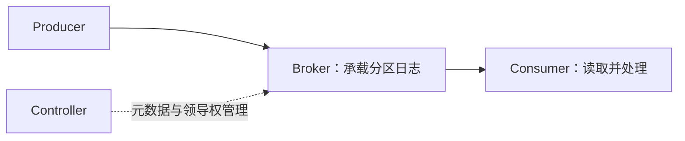

# 核心组件与整体架构

状态：已展开，待理解确认

核心问题：Producer、Broker、Topic、Partition、Consumer Group、Controller 各承担什么职责？

## Step 1：先区分逻辑分类与实际存储

**Topic 是消息的逻辑分类，Partition 是这个 Topic 下的一份有序日志，Broker 是承载分区副本的服务节点。**

```text
Kafka 集群
├── Broker 1：承载 orders 的 P0 Leader 副本
└── Broker 2：承载 orders 的 P1 Leader 副本

逻辑上：
Topic orders
├── Partition 0：[A][B][C]，Offset：0、1、2
└── Partition 1：[D][E]，   Offset：0、1
```

图中只展示 Leader 副本的位置，其他副本后续再讲。

- 一个 Topic 可以有多个 Partition，分布在不同 Broker 上。
- 一个 Broker 可以承载不同 Topic 的多个分区副本。
- Topic 不是一台机器，也不是某个 Broker 独占的目录。
- 不同 Partition 的 Offset 各自编号，不能用一个 Offset 表示整个 Topic 的消费进度。

## Step 2：把各组件放到链路上

| 组件 | 职责 |
| --- | --- |
| Producer | 指定 Topic，按分区规则选择 Partition，将消息发送到对应 Leader 所在的 Broker |
| Topic | 为一类消息提供逻辑名称，例如 orders |
| Partition | 保存该 Topic 的一部分消息，形成独立有序日志 |
| Broker | 承载分区副本，处理写入、读取、复制与日志清理 |
| Consumer / Consumer Group | Consumer 读取并处理消息；同组分摊分区，不同组独立订阅与记录进度 |
| Controller | 管理集群元数据，协调分区 Leader 选举等管理操作 |



**普通消息读写主要走客户端与 Broker 的数据链路，不需要先经过 Controller 转发。**

Broker 和 Controller 是服务角色，部署时可以分离，也可以由同一进程同时承担。

## Step 3：Consumer Group 为什么单独存在

**Partition 是分配工作的单位；Consumer Group 是共同完成一份订阅的消费者集合。** 消费者读取的是分区里的消息，通常向该分区 Leader 所在的 Broker 拉取；一个消费者可以从多个 Broker 读取所负责的分区。

通过相同的 `group.id`，多个消费者加入同一组。Group 是逻辑身份，不是另一个存储节点，也不是消息转发层。

以同一个 orders Topic 的两个分区为例，在常规消费组订阅模式下：

```text
消费组 X
├── Consumer X1 → P0
└── Consumer X2 → P1

消费组 Y
└── Consumer Y1 → P0、P1
```

同组内，一个分区同一时刻分配给一个消费者；一个消费者可以负责多个分区。

这解决两个问题：

- **同一业务扩容**：统计服务启动两个实例，使用同一 `group.id`，分别负责 P0、P1，共同处理一份消息流。X1 退出后，组协调机制可以将 P0 重新分配给其他成员。
- **不同业务订阅**：统计与通知使用不同 `group.id`，各自读取 P0、P1，各自获得一份消息流，进度互不影响。

提交的消费进度按 **Group + Topic + Partition** 区分。例如 X 对 P0 的提交位置为 10，Y 对 P0 的提交位置可以为 3；换一个消费者接管 X 的 P0 时，可以从 X 已提交的位置恢复。

在两个分区都分配完后，给同一组增加第三个消费者，并不能让三个消费者同时分摊这两个分区。

RabbitMQ 对照：同组分摊类似同队列的竞争消费；不同组独立订阅类似为不同业务绑定独立队列，但 Kafka 的各组共享逻辑分区日志。

“同组分摊”不保证消息永不重复处理，故障恢复与提交时机仍可能造成重复。组内分配与 Offset 提交的细节后续展开。

## Step 4：与 RabbitMQ 对照

RabbitMQ 常规链路：Producer → Exchange 路由 → Queue → Consumer。

Kafka 常规链路：Producer 选择 Topic 的 Partition → 对应 Broker → Consumer。

Kafka 没有一个必须逐条经过的 Exchange 式路由组件。**Topic 是逻辑分类，不能直接等同于 Exchange。**

## 本节只记住这一点

**Topic 分类别，Partition 存日志，Broker 承载副本；Producer 写，Consumer 读，Group 划分订阅与进度，Controller 管集群元数据。**

自检：一个 Topic 有两个分区，是否意味着必须有两个 Broker？一个 Broker 能否承载多个 Topic 的分区？
